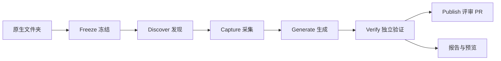

# 架构设计

系统只有一条生产工作流：原生 SolidWorks 文件夹 → Airflow 六阶段 → 独立验证 → URDF 预览与评审 PR。架构以正确性、能力完整、职责清楚、可恢复、可测试和实际执行效率为验收依据。最终系统精简的是重复权威、失效入口和无用兼容，不以改动量、抽象数量或删除行数限制必要重构。

本文说明模块职责与设计理由。[系统契约](contracts.md)定义数据和状态边界，[机械规范](mechanical-handoff-spec.md)定义工程语义，[质量规范](quality.md)定义判据与容差，[操作指南](operations.md)和[部署指南](deployment.md)分别面向工程使用与平台维护。协议字段和阈值只在各自规范中维护。

会话和项目文档使用中文；代码、注释、错误、日志和界面使用英文。原生名称及文件内容作为输入原样保留。

## 工作流与职责



六阶段的输入、检查和输出见[六阶段契约](contracts.md#stages)。每阶段从已登记不可变命令重建自己的输入闭包；阶段之间不依赖进程内对象、可变临时目录或前一阶段仍存活的会话。

| 边界 | 唯一职责 | 不持有的权威 |
|---|---|---|
| 浏览器与 Portal | 认证、上传、提交意图、查询、报告与预览 | 工程推导、阶段成功和 CAD 控制 |
| Airflow DAG | 依次调度六个 `StageTaskOperator` | 领域状态机和工程检查 |
| `StageTaskOperator` | 绑定真实 task context，执行、让渡与恢复同一阶段 | 副作用发送资格和阶段判据 |
| `EffectPollTrigger` | 只读观察既有 effect，产生唤醒提示并释放 worker | claim、发送、取消、封存或成功资格 |
| `StageApplication` | 接纳、构造命令、组合六个 handler、路由对账和取消 | CAD 原生事实、网页授权 |
| 共同 stage engine | claim、执行、候选校验、唯一 decision 及失败保全 | 各阶段领域算法 |
| Linux handlers | 冻结、原生协调、模型生成、独立验证与发布 | Windows 会话所有权 |
| Windows native runtime | 已保存 CAD 原生事实读取、几何观察、会话管理，以及释放后的原值投影、raw/STL 编码与证据封包 | 完整模型、URDF、独立质量结论、Git 和 PR |
| deploy/operator/windows_identity.py | operator 与恢复共用的 Windows 进程证据结构及 sealed source 上下文绑定校验；不解释 Windows Task、CIM 或 pyvenv，不持久化第二份模型 |
| PostgreSQL `FactStore` | 接纳、命令、执行权、effect 与阶段决定 | artifact 文件内容和 Airflow 调度状态 |
| `ArtifactStore` | 不可变文件集合、manifest、摘要及物化 | 运行成功、阶段决定和业务显示状态 |

Linux 完成上传与 Freeze 后，Windows 为 Discover 和 Capture 分别物化受控输入、建立并释放自己的原生会话。Discover 返回原生观察，Linux 形成 prepared package；Capture 返回原生证据，Linux 接纳并独立核验传输。SourceSet archive 与 prepared archive 是不同对象，分别记录摘要，并证明同一封存原件血缘。等待 Linux 时不占用 CAD 会话，不引入跨 operation 的可变来源缓存。

## 数据权威

| 事实 | 来源及约束 |
|---|---|
| 文档、配置、实例、拓扑、几何、质量和原生声明 | 当前冻结 CAD 与可审计直接观察；保留缺失、读取失败和冲突的区别 |
| 名称、单位、坐标和方向修正 | CAD 原值与版本化通用规则；保留原值、适用依据、结果和字段级 warning |
| 用途、配置目标、提交说明和发布路由 | 认证提交与已接纳不可变配置；只建立相应行政身份 |
| 规范化模型与 URDF | 从完整原生证据推导的待验证声明；只有一个持久化 `EngineeringModel` |
| 验证结论 | 从原始证据与实际交付字节独立复算，绑定 verifier、规则及 subject |
| 执行、恢复和阶段成功 | 数据库中的不可变命令、执行权和追加事实；文件存在或网页绿标不建立资格 |
| 工程批准和硬件资格 | 独立工程验收；PR、仿真加载或流水线通过均不代授 |

CAD 有值时先读取、保留和检查，再按有据规则修正。规则不能复制手工答案、补造原生缺项或掩盖冲突；手工参考仅作为独立参考单元测试和回归测试数据，不进入生产采集、生成、验证真值或发布必经链。非直读值逐对象、逐字段显示来源 warning。命名、方向、限位以及已获允许的参考差异以[身份与来源](contracts.md#identity)和机械、质量规范为准。

外观身份只保留同次原生观察：材质实体的 public QI 集合、实际 owner 引用，以及 Part face 到 body/feature 的关系。交付 face footprint 由 Generate 和 Verify 分别从这些事实建立，不把 geometry index 与 Part identity 假定为一对一，也不保存 Source 自匹配答案。live COM handle 与可封存 JSON 事实分离，接口类型、body 归属和生命周期不能靠测试标签或对象深复制建立。

完整上传、选定原生依赖闭包、prepared package、artifact 集合、tool source、完整 tool record 和交付 subject 的摘要属于不同语义域。逐域核验，不能因两个摘要不同就认定内容冲突，也不能以其中一个代替另一个。

新运行只能从 Freeze 接纳。首次上传封存新 originals；Freeze successor 仅复用父运行已验证的 originals，当前请求、规则、配置、目标、Git 基线和工具要求重新封存，重新执行六阶段。不得继承父运行下游 decision 或成功资格。同一已登记命令的受控重试与新建运行是两种操作，详见[状态与恢复](contracts.md#recovery)。

## 模块与依赖

| 目录 | 职责 |
|---|---|
| `pipeline/` | 阶段契约、接纳、共同引擎、领域 handler、effect、取消和对账；`application.py` 为生产组合入口 |
| `sources/solidworks/` | 原生来源、冻结、发现、采集事务与证据封包 |
| `geometry/` | 原生几何表示、拓扑与网格算法 |
| `model/`、`backends/` | 唯一规范化工程模型及 URDF 编码 |
| `verification/` | 从原始观察和实际产物独立复算机械、网格、运动与声明 |
| `artifacts/` | 不可变 artifact 存储与物化 |
| `platform/` | canonical facts、查询投影及诊断存储组合 |
| `orchestration/` | Airflow、HTTP/native operation、Portal、认证和传输适配 |
| `repository/` | 固定目标及基线下的候选分支、Git 和 PR 适配 |
| `build/`、`deploy/` | 确定性打包、受管安装、健康、数据库切换与灾难恢复 |

核心调用链是：

```text
Airflow DAG -> StageTaskOperator -> StageApplication.run_stage
            -> execute_stage -> StageHandler -> StageResult / StagePending
StagePending -> EffectPollTrigger -> StageTaskOperator.execute_complete
             -> StageApplication.resume_stage -> execute_stage
```

共同引擎不包含 CAD、URDF 或发布算法。各 handler 只持有所需 artifact 和 effect 端口，不能直接提交平台成功。生产组合必须完整安装六阶段、native/Git/PR 对账及 native 取消能力；测试可显式注入端口，缺失生产组件不得被当作可选功能静默忽略。

Discover result 表达原生选择、prepared 输入和证据绑定，不作为第二个完整机器人模型。Generate 持久化一个 `EngineeringModel`，URDF 是其交付编码。Verify 独立读取原始证据和实际输出，不借用生成器的期望值、成功标志或缓存。共享代码限于纯数学、格式解析和无领域推导的契约基础，并用解析解、已知答案和变异反例验证。发布重验完整 certificate、execution receipt 及被验证字节。

Capture 在一次原生采集中保留已保存配置、几何、轴线、配合、物性和外观事实，不执行 CAD 重建，不保留重建图、恢复日志或强制清零资格。原生事实以 manifest 绑定的 raw 成员为唯一封存来源，交付 capture 记录只保留必要投影，不重复内嵌完整 raw。外观复用同一几何遍历的对象与 face triangle spans；对象引用必须在已证明的同一文档与 occurrence 上下文中解释。Generate 离线完成坐标转换、面材质分组和 URDF 生成，Verify 从原始事实与交付字节独立复算；不得信任采集器预填的匹配答案。详细外观规则见[原生外观读数与交付](contracts.md#原生外观读数与交付)。

Windows 的既有 `native_operation_event` 经同一 operation view 与 poll 形成 `run_display_metadata.activity`，Portal 展示当前活动、时间与历史。原生 sequence 与事件时间用于识别重复观察；activity 是显示数据，不建立第二套阶段状态、成功资格或 CAD 控制权，不增加独立轮询链。

## 持久化与一致性

数据库保存 `RunAdmission`、`StageCommand`、`ExecutionClaim`、candidate、唯一 `StageDecision` 及 append-only effect facts。`ArtifactStore` 先从私有 staging 校验并原子发布不可变文件集合，数据库随后登记引用；两者之间的崩溃窗口通过原 command/effect/candidate 对账。数据库不可用时停止业务写入，不回退到文件状态。

successor 创建、claim 取得、外发授权和 decision 提交各自重验当前命令及完整有界祖先链。锁顺序由数据库实现统一维护；claim 事务核对 effect、执行者和现有执行权，不在该事务内检查 cancellation。engine 在取得 claim 前检查取消请求；外发授权和 decision 提交再在各自事务中核对当前 cancellation、effect、owner 和 fence，取得 claim 本身不能绕过后来发生的取消。外部 HTTP、CAD、Git 和 PR 调用在发送授权事务提交后执行，不跨外部调用持有数据库事务。旧 fence 不得提交或关闭新的执行权。

Airflow 只拥有实际调度状态。`project_stage_status`、`project_run_status` 从 canonical facts 生成业务投影；Portal、SQL view 和维护脚本不另建 reducer。`RunControlStore` 只控制显示名、隐藏与恢复显示。维护查询在同一只读 repeatable-read 快照中核对业务投影和真实 Airflow 关联；显示隐藏不删除证据或改变运行资格。

只有六个正式阶段按序完成且全部相关 effect 已满足，运行才成功。诊断阶段通过、文件完整、服务健康或 task 成功都不能替代这一条件。`DiagnosticReplayScope` 保留历史生产者与本次工具身份，只产生隔离诊断资格，不能晋升为正式下游输入。

## 外部副作用与恢复

每个副作用先登记唯一 intent 和可复原 outbound，再在当前 claim/fence 下提交发送授权。响应不明保持 UNKNOWN；超时、断连、单次 404、租约到期和日志提示都不证明外部操作未发生。共同对账 API 根据原 effect kind 选择只读 observer，核验并封存观察，不重新发送。

等待 effect 时，engine 原子让渡执行权并返回 `StagePending`。trigger 仅观察；worker 恢复时重验持久 wait、真实 task context、祖先资格和当前 effect。终态 observation 经原 handler 消费，成功仍由候选校验与唯一 decision 建立。已有 decision 只复核返回，不重新执行。

原 operation 已 accepted 但 input 未 admitted 时，允许[受限输入续传](contracts.md#受限-transfer-continuation)。取得 `transfer_resume` claim 仅允许准备原 archive，尚不授予发送权。handler 验证原字节后，通过独立授权事务重新核对祖先、取消、租约和当前 effect，再追加 `resume_authorized`。只有该事务提交后才可向原 operation 上传原 archive；之后再次让渡。此端口不能创建新 effect、提交 candidate/decision 或代替 Git/PR 对账。claim 与发送授权之间崩溃、取消或事实变化不能绕过第二次检查。

确定领域失败保留失败结果或 `FailureEnvelope`；未结算 effect 不能被隐藏成失败成功二选一。未处理异常保留 workspace、claim 和原始诊断，等待对账。诊断封存错误不覆盖首个工程错误。取消有独立受控命令，取消 ACK 只证明取消请求的结果，目标 operation 仍需核验终态。

## 运行身份与资源

平台配置只保存不可变 snapshot；Airflow 连接持有引用。接纳从同次读取的 snapshot bytes 与唯一 install record 校验 `NativeTargetIdentity`，并将其固定到请求、命令、effect 和 native operation。当前 URL、health、环境或 trigger event 不能改绑旧命令。服务端在 create/upload 前同时核验 expected target、原 operation target 和当前 runtime，避免 health 与 upload 之间切换目标。

Linux 与 Windows 使用同一源码发行、各自最小依赖与角色工具身份；跨角色 artifact digest 不要求相等。安装记录、DAG 来源、实际包、配置和 endpoint 身份分别核验。只有依赖 Windows/SolidWorks 的原生工作在 Windows 上运行。

每个原生 operation 独立管理物化目录和自有会话；Discover 与 Capture 都先核对封存原件、配置和对象归属。虚拟件以所属装配、原生身份、配置与受控会话证明来源，不用临时路径充当上传原件。原生几何 schema、API 读数、失败拒绝及派生规则统一见[原生交换协议](contracts.md#exchange)。

CAD 排他来自实际资源所有权，不来自 Airflow 并发数字。只能关闭可证明属于本操作的会话；未知会话或不明 COM 状态拒绝继续。租约到期不是终止许可。部署、启动、对账和切代共用维护锁，不能开启第二资源域。

## 保留机制的理由与验收

| 机制 | 必要性 |
|---|---|
| 共同 engine 与薄 Airflow adapter | 生产、重试和诊断遵循同一执行规则，调度器不复制领域状态机 |
| claim/fence 与分离的发送授权 | 排除并发写者，并在真正外发前重新验证可变事实 |
| `StagePending` 与只读 trigger | 长时间等待释放 worker，唤醒不携带成功或发送资格 |
| 受限续传端口 | 在保留原 operation/原 archive 的条件下恢复丢 ACK，不重建 CAD 任务 |
| facts 与 artifact 分离 | 业务决定与不可变字节分别只有一个权威，保留可复原证据 |
| 独立 Verify | 检出生产者的错误，避免生成结果互相自证 |
| typed 灾难恢复与一次性旧表切换 | 完整保存事实引用、失败原件、身份和权限，验证可恢复后实际删除旧权威 |

旧 Store、文件 checkpoint writer、job/rerun/cache HTTP 和另一套发布链不属于最终生产接口。历史原件只保留验证和显式迁移所需能力；不能恢复旧入口作为 fallback。旧数据库表的删除先完成可核验备份、独立恢复和受控切换，具体规程见[灾难恢复](contracts.md#灾难恢复)。

最终候选须交付目录职责、附搜索证据的实际删除清单、新增复杂性理由，以及绑定固定源码的默认工厂六阶段、失败/取消/UNKNOWN、跨进程恢复和真实 Airflow 验证。发行再遵循[开发与发行链路](deployment.md#开发与发行链路)：根审固定 PR、必需 CI、根合并、干净 main 构建、同版双端部署及真实工程端到端验收。局部或离线通过不代替后续资格。
