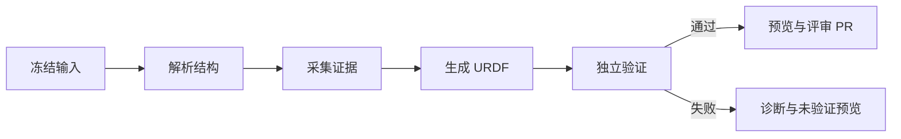

# 架构设计

系统将一份原生工程转换为可审查的模型交付。设计围绕三个约束展开：工程事实有明确来源，跨边界结果不可变，验证结论只适用于其绑定的文件与检查范围。

系统保持最小完整形态：一条工作流、一个完整模型、每项规则一个属主。目录对应明确职责，模块边界服务于独立验证和必要副作用；重复入口、并行表示、兼容流程及过渡层随变更移除。文档各自拥有一个职责，直接描述支持的行为。

## 工作流与职责

六个阶段及其输入、检查、输出由[系统契约](contracts.md#stages)统一定义。Airflow 调度这些阶段；操作台提交命令和展示结果。两者都不实现机械推导或质量判定。

| 边界 | 职责 | 持有的数据与凭据 |
|---|---|---|
| 浏览器 | 飞书登录、上传、主装配、目标与用途选择、结果与预览 | 用户选择的文件和会话 |
| Linux 平台 | 冻结、规格解析、推导、生成、验证、报告、发布与持久化 | 工程证据、规格快照、模型仓库和 Git 凭据 |
| Windows 原生执行器 | SolidWorks 原生读取、重建、质量属性读取、网格导出和会话管理 | 临时工程副本、原生任务、资源所有权和传输凭据 |
| 工程评审 | 设计与实物对应、全行程安全、参数真实性和用途批准 | 受控工程记录与对应 PR |

Windows 遵循最小职责原则：只有依赖 Windows/SolidWorks 的操作才在其上执行。它不推导结构，不计算质量闭包，不生成模型或报告，不运行 MuJoCo，不维护产品身份、规格库、发布路由或 Git 状态。两端执行同一源码发行版本，使用各自最小依赖集。

## 数据权威

| 事实 | 权威来源 | 生成物的地位 |
|---|---|---|
| 文档、配置、实例、几何、基准、配合和原生声明 | 已保存的 CAD 与直接原生观察 | 保留来源，不能反写或补造 |
| 工作限位、驱动能力及独立预算 | CAD 中的有效定义或明确引用的受控规格 | 固定引用、原文与摘要 |
| 检查与预览的分析窗口 | 冻结用途与唯一检查策略，或明确绑定的预览声明 | 标记派生来源，不建立工程限位 |
| 产品路由、提交主体、运行身份 | Linux 配置与认证提交 | 只建立行政身份 |
| 规范化模型、URDF、交付网格 | 原生证据经确定规则推导；原生网格是源观察，交付网格是其无损分片与放置 | 待独立验证的声明 |
| 自动质量结论 | 独立验算及实际交付文件 | 绑定主体和检查策略 |
| 工程批准与用途资格 | 工程负责人及对应验收记录 | 平台不推断批准 |

原始 CAD 缺项保持缺项。认证提交人不能代填结构负责人，内容摘要不能冒充工程修订，平台上传索引不能冒充 CAD/PDM 原件控制记录。评审候选可以如实携带这些行政缺项，但必需机械证据和自动检查不能缺失。具体逐字段来源与发布规则见[系统契约](contracts.md#identity)；工程表达见[机械规范](mechanical-handoff-spec.md)。

原请求由冻结阶段先于生成器封存为 `input/request.json`，后续原字节传递。它是用途的唯一权威，与原生读数共同构成字段来源的独立输入；工程内容身份和发现结果仍是待核对的生成声明。该文件使离线验证能够核对用途、真实配置目标和提交说明，避免生成物互相自证；它只保存不可变证据，接纳、完成与复用资格仍由平台数据库登记，不产生另一份可变业务权威。

工程用途与检查预览用途共用六阶段、规范化模型、独立验证和发布入口。用途不改变原生事实；缺失、读取失败和冲突分别处理。检查预览允许如实缺少工程范围或驱动参数，采用有据的有限分析窗口并保留全部适用检查，工程范围、驱动和实机资格明确未建立。窗口派生与资格规则只有一个策略属主，推导与验证分别依据冻结请求和原始观察应用；不增加预览专用模型、验证器或权威文件。具体编码见[用途契约](contracts.md#purpose)。

完整上传、原生选择与完整制备包是不同的清单对象。冻结登记完整上传；原生传输及其后继阶段保留原生选择身份；制备包清单另外核验生成身份、受控规格和归档原生件。收据投影从对应阶段的既有证据取得绑定，不能把制备包摘要当作原生摘要，也不能为使摘要一致而重写封存观察或改变原始相对路径。具体绑定见[交付格式](contracts.md#delivery)。

## 领域组织

系统是一个模块化应用，部署在一台 Linux 主机与一个串行 Windows 执行端。领域逻辑不依赖 Airflow、HTTP、页面或部署脚本。

| 领域 | 唯一职责 | 允许依赖 |
|---|---|---|
| 契约基础 | 类型、schema、路径、规范序列化、摘要、阶段和判据定义 | 标准库与纯基础算法 |
| 原生适配 | 读取 SolidWorks、绑定实例与会话、封存原始观察 | 契约基础与 Windows API |
| 结构推导 | 原始观察与规格快照转为采集计划 | 契约基础 |
| 生成 | 完整证据转为规范化模型及 URDF/网格 | 契约基础与模型表示 |
| 独立验证 | 从原始证据重建预期并检查实际产物 | 契约基础与独立验证算法 |
| 发布 | 交付重验、Git 提交、PR 确认与幂等恢复 | 契约基础与验证入口 |
| 编排 | 命令、运行、阶段、检查点、资源约束与适配器 | 领域入口 |
| 展示 | 操作台、报告与预览 | 编排查询结果与封存文件 |

推导与验证各自实现机械解释；验证不能导入推导、生成或编排模块，不能借用其模型、缓存、成功标志或期望值。可共享无业务推导的数学原语、格式解析器和契约常量；共享内容本身须有解析、解析解和反例测试。发布调用完整验证入口，禁止另写简化验收。

采集计划只描述要读取的原生对象、选择集合、基准和证据项目，不承担完整机器人模型的第二种表示。完整模型只有一个规范化表示，URDF 是其交付编码。报告与页面由同一结构化结果投影，展示操作没有工程执行副作用。

## 跨主机执行

1. Linux 完成上传、路径准入和不可变冻结，固定主装配、工具版本与提交请求。
2. Windows 接收一次工程副本，在自有 SolidWorks 会话中解析主装配，读取依赖绑定和原始结构观察，封存发现结果并释放会话。
3. Linux 核验原生结果，解析并封存受控规格，选择机械解释模式，生成绑定发现摘要的采集计划。
4. Windows 复用同一工程副本，重新建立自有会话，核对计划及实例身份，重建并读取物理属性、轴线和网格，封存完整证据后释放会话。
5. Linux 核验完整传输，生成模型，执行独立验证，并发布候选 PR。

等待 Linux 推导时不占用 CAD 会话。原生执行器串行处理需要 CAD 的操作；传输、Linux 验证与报告不占用 CAD 资源。原生副本在发现与采集之间不得修改或重新上传。

依赖闭包依据 SolidWorks 实际解析的绑定判定。包外、缺失或无法与封存来源绑定的依赖拒绝进入采集。此检查发生在引擎解析之后，不构成操作系统文件访问沙箱；执行主机不向任务暴露无关工程目录或共享盘。

原生声明与配合推导是同一工作流的两种机械解释。声明存在且有效时采用声明；原生读取明确证明声明不存在时才采用配合推导。损坏、不可读或未判定的声明不能触发隐式回退。两种解释的工程边界见[机械规范](mechanical-handoff-spec.md#structure)。

## 持久化与一致性

Linux 的平台数据库是请求、运行、检查点引用、显示元数据和发布意图的唯一可变权威；与 Airflow 元数据库使用同一 PostgreSQL 实例、不同 schema 和权限。Airflow 拥有任务调度状态，平台阶段收据是工程结果权威，页面只读取平台投影。任务成功不能替代工程收据；两者不一致时由编排对账，运行成功要求六阶段收据完整、发布已确认且调度不存在在途操作。

生产调用必须闭合为：认证提交在准入事务中登记请求/运行/派发意图，派发器绑定真实 DAG run，六任务在执行前登记阶段与操作意图，产物封存后登记阶段结果及事件，门户与维护读取数据库投影。禁止从 `meta.json`、`events.json`、目录扫描或文件阶段收据重建另一份业务状态。Windows 的原生操作和 CAD 所有权账本只记录端点已发生事实，由 Linux 对账确认；它们不承担平台运行或发布状态。

维护报告与开关闸门只读取准入与生命周期两个受控视图，在同一只读事务中取得一致快照。对账写端在同一短事务内按已登记身份核验所需的原始 Airflow 任务和 DagRun 事实，仅具有必要列的读取权限，不写调度状态、不建立状态副本。生命周期视图直接关联平台派发意图和真实 Airflow 任务，统一解释活动、终态、未决与未知；不保存第二份调度状态。绑定或源记录缺失仍保留未知对象，权威不可读则拒绝维护操作。调度重试保持同一任务绑定，不能改写已封存的工程终态。

大文件存放在专用文件存储中，以闭合清单与摘要封存。写入临时目录、核验并原子提交后，数据库事务才登记可消费的检查点。崩溃留下的未登记文件不能被下游采用；登记成功的检查点不得覆盖。定期对账恢复未完成调度与外部操作，不依赖网页持续轮询。

新请求、关联运行与初始派发意图在一个短准入事务中登记，与关闭准入共用同一门锁。阶段状态与收据登记在同一事务中；重试使用相同幂等键，发布前登记外部操作意图。数据库事务不跨 HTTP、CAD 或 Git。跨系统一致性由摘要核验、幂等调用、条件写入和事后确认建立。

数据库不可用时停止业务状态变更，不降级到文件权威。跨文件与数据库提交的崩溃窗口通过原意图和封存清单对账；未登记对象不作为成功检查点，已经登记的完整对象不得因重试覆盖。历史数据迁移按来源可证明范围登记，无法确认的结果保留未决，不通过批量改终态消除维护阻塞。

已登记派发意图缺少任务绑定、或外部已终止而平台仍为排队且没有阶段行，属于同一对账职责。既有 `reconcile` 可在证据充分时补齐原操作的缺失绑定并登记真实结果；不增加旧版专用流程、不复制调度状态、不缩窄生命周期视图或排空门。已知绑定不改写，无法唯一核定的绑定和结果继续保持未知。 冻结失败而后继未派发的请求也由此入口收口：依据实际调度终态和未认领的派发事实，保留冻结诊断并取消未发出的意图，不制造原生回执或执行事实。

## 资源与失败边界

CAD 资源以端点级独占租约及可核验的进程身份管理。只能访问、关闭或终止自己创建且仍能证明身份的会话；未知会话导致拒绝执行。超时或租约过期只说明需要恢复，不能赋予终止权限。具体规则见[资源契约](contracts.md#resources)。

Linux 不同运行使用独立工作目录。发布按仓库与硬件目标串行；远端变更用显式前置提交与条件更新防护，本地锁不能代替远端校验。

网络错误不证明原生失败，也不触发新 CAD 作业。重连查询同一操作；原生终态失败保留诊断，工程重跑创建新运行并明确复用范围。验证失败阻断发布，发布失败保留已验证交付和所有可确认的外部结果。

完整恢复规则由[系统契约](contracts.md#recovery)定义。[质量规范](quality.md)定义自动结论与用途边界，[操作指南](operations.md)定义工程师的处理流程，[部署指南](deployment.md)定义平台维护。
