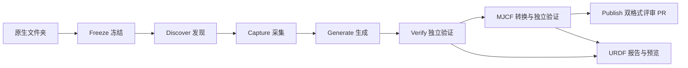

# 架构设计

系统只有一条生产工作流：原生 SolidWorks 文件夹 → Airflow 七阶段 → 独立验证 → URDF/MJCF 预览与评审 PR。架构以正确性、能力完整、职责清楚、可恢复、可测试和实际执行效率为验收依据。最终系统精简的是重复权威、失效入口和无用兼容，不以改动量、抽象数量或删除行数限制必要重构。

本文说明模块职责与设计理由。[系统契约](contracts.md)定义数据和状态边界，[机械规范](mechanical-handoff-spec.md)定义工程语义，[质量规范](quality.md)定义判据与容差，[操作指南](operations.md)和[部署指南](deployment.md)分别面向工程使用与平台维护。协议字段和阈值只在各自规范中维护。

会话和项目文档使用中文；代码、注释、错误、日志和界面使用英文。原生名称及文件内容作为输入原样保留。

## 工作流与职责



七阶段的输入、检查和输出见[七阶段契约](contracts.md#stages)。每阶段从已登记不可变命令重建自己的输入闭包；阶段之间不依赖进程内对象、可变临时目录或前一阶段仍存活的会话。

检查预览可从当前保存的原生命名基准与轴建立 `inspection_saved_native_carrier/v1` 声明。该规则复用已有用途、采集计划、模型及来源警告；不增加运行入口、配置开关或第二份工程模型。原始对象、作用域、配置、刚性求解声明、根和几何接口均须成立；名称只选择具有同次几何证据的候选。Source 与独立 Verify 分别解释原始事实，后续阶段仍消费同一载体。规则不授予刚体附着、实际自由度、正运动或硬件资格；具体边界见[机械交付规范](mechanical-handoff-spec.md#保存的原生命名基准与检查预览)。

| 边界 | 唯一职责 | 不持有的权威 |
|---|---|---|
| 浏览器与 Portal | 认证、上传、提交意图、查询、报告与预览 | 工程推导、阶段成功和 CAD 控制 |
| Airflow DAG | 按共同执行范围调度七个 `StageTaskOperator` | 领域状态机和工程检查 |
| `StageTaskOperator` | 绑定真实 task context，执行、让渡与恢复同一阶段 | 副作用发送资格和阶段判据 |
| `EffectPollTrigger` | 只读观察既有 effect，产生唤醒提示并释放 worker | claim、发送、取消、封存或成功资格 |
| `StageApplication` | 接纳、构造命令、按已登记命令或执行范围装配所需 handler、路由对账和取消 | CAD 原生事实、网页授权 |
| 共同 stage engine | claim、执行、候选校验、唯一 decision 及失败保全 | 各阶段领域算法 |
| Linux handlers | 冻结、原生协调、模型生成、URDF/MJCF 独立验证与组合发布 | Windows 会话所有权 |
| Windows native runtime | 已保存 CAD 原生事实读取、几何观察、会话管理、原值序列化与证据封包 | 语义投影、惯量规范化、STL、完整模型、URDF、独立质量结论、Git 和 PR |
| Windows 生命周期脚本 | 当前任务、进程归属、安装身份、ACL 和健康的现场核验 | 业务阶段决定；Linux 控制与恢复只消费其核验结果 |
| PostgreSQL `FactStore` | 接纳、命令、执行权、effect 与阶段决定 | artifact 文件内容和 Airflow 调度状态 |
| `ArtifactStore` | 不可变文件集合、manifest、摘要及物化 | 运行成功、阶段决定和业务显示状态 |

Linux 完成上传与 Freeze 后，Windows 为 Discover 和 Capture 分别物化受控输入、建立并释放自己的原生会话。Discover 在同一个自有会话中打开指定主装配，从同次观察形成来源闭包和机械事实；搜索环境恢复与会话释放完成后才封存和裁剪目录。Capture 仍需依据 prepared 计划读取分组物性与轴等原生事实，不把两阶段合成跨 operation 的长驻会话。Linux 接纳 Capture 时只核必要字节、schema、身份、scope 和计划绑定；Generate 执行一次语义投影。SourceSet archive 与 prepared archive 分别绑定摘要并证明同一原件血缘，等待 Linux 时不占用 CAD。

Windows 工作目录直接使用已登记的唯一 claim，不在路径中重复嵌套 operation 标识，输入相对路径与字节保持原样。Capture 发生异常时，原生会话边界按实际释放结果记录资源结算；成功释放后的领域失败与清理未证明的 UNKNOWN 分开处理。原始结构化错误通过既有失败链保留至 GUI，不用笼统超时替代已收到的失败响应。

保存状态导出允许已知缺失引用形成详细来源 warning 后继续，不要求 CAD 参数化重建完整。Discover 与 Capture 共用打开状态判定：文档存在、错误类型明确允许且必要事实可读时继续；未知或严重错误仍拒绝。未授权包外来源不能被搜索结果替代。原件不保存、不重建；实际读取范围与未证明的源完整性分别记录。独立 Verify 从原始观察核对输出和 warning，报告、预览与 PR 不把保存状态导出成功等同于总体机械或硬件资格。

两阶段独立打开的诊断分别保留在同一来源 warning 中，只对同一次观察核验记录一致性。原生 closure 始终保留已读取的 occurrence 范围，由独立验证与同次 raw 对照；不因打开干净而省略来源核验。纯本地 Generate／Verify 的显式领域拒绝通过已有失败封套和事务收敛，执行器身份与未知外部效果仍保留独立边界。

未读来源只有在当前原生抑制状态与唯一封存排除项、完整实例、冻结定义者字节、定义上下文及引用路径一致，且没有活动或未知后代、没有配合依赖时，才能作为未导出项排除。独立 Verify 报告该实例的排除事实，保留原始来源错误与保存状态 warning；它不获得已绑定生产来源资格。缓存和内嵌来源的逐项匹配要求不因此放宽。

限位策略 warning 按独立重算的最终交付值核对，包括获准的缺失驱动零占位。方向 warning 的独立归一化父坐标单位轴复用有向轴验证的 `1e-12` 绝对容差；其余字段、对象身份和数量保持精确比较，原始证据字节绑定不变。

部署只维护当前发行的首次安装和运行。主机先满足支持矩阵中的 CPython、系统服务与原生软件条件；双端产品及 Python 依赖从固定 main 的离线角色资产安装同一发行。Linux 首次安装和同版恢复均消费经发行摘要验证的 wheelhouse，pip 禁止访问索引。已存在的安装或身份不明残留不能自动覆盖；安装失败保全诊断、停止本次启动的写者并保持准入关闭，不切换或恢复历史发行。

Linux 控制入口负责安装、启动、排空、停止、状态、健康和当前业务 effect 对账；Windows 入口负责当前执行端的安装和生命周期。删除 stage/promote/rollback、跨代控制器委派与历史包适配。业务 UNKNOWN 对账、受控重试和资源释放仍由 StageApplication、FactStore 与资源所有权规则决定，部署工具不复制业务恢复逻辑。同版业务数据的备份与灾难恢复保持独立，不依赖历史发行切换记录。

配置原件、不可变 snapshot 与安装记录保持明确绑定：snapshot 文件摘要等于安装记录的摘要，原始配置摘要等于 snapshot 内的来源摘要。派生环境由当前发行校验后作为数据消费，禁止执行环境文件；health 与维护共用 reader，按消费者需要投影字段。实际包身份复用 `runtime.tool_record()`，服务集合复用 systemd inventory，维护互斥依赖实际文件锁，不新增 registry 或状态副本。

## 数据权威

| 事实 | 来源及约束 |
|---|---|
| 文档、配置、实例、拓扑、几何、质量和原生声明 | 当前冻结 CAD 与可审计直接观察；保留缺失、读取失败和冲突的区别 |
| 名称、单位、坐标和方向修正 | CAD 原值与版本化通用规则；保留原值、适用依据、结果和字段级 warning |
| 用途、配置目标、提交说明和发布路由 | 认证提交与已接纳不可变配置；只建立相应行政身份 |
| 规范化模型与 URDF | 从完整原生证据推导的待验证声明；只有一个持久化 `EngineeringModel` |
| 验证结论 | 从原始证据与实际交付字节独立复算，绑定 verifier、规则及 subject |
| 执行、恢复和阶段成功 | 数据库中的不可变命令、执行权和追加事实；文件存在或网页绿标不建立资格 |
| 工程批准和硬件资格 | 独立工程验收；PR、仿真加载或流水线通过均不代授 |

CAD 有值时先读取、保留和检查，再按有据规则修正。规则不能复制手工答案、补造原生缺项或掩盖冲突；手工参考仅作为独立参考单元测试和回归测试数据，不进入生产采集、生成、验证真值或发布必经链。非直读值逐对象、逐字段显示来源 warning。命名、方向、限位以及已获允许的参考差异以[身份与来源](contracts.md#identity)和机械、质量规范为准。

外观身份只保留同次原生观察：材质实体的 public QI 集合、实际 owner 引用，以及 Part face 到 body/feature 的关系。交付 face footprint 由 Generate 和 Verify 分别从这些事实建立，不把 geometry index 与 Part identity 假定为一对一，也不保存 Source 自匹配答案。live COM handle 与可封存 JSON 事实分离，接口类型、body 归属和生命周期不能靠测试标签或对象深复制建立。

完整上传、选定原生依赖闭包、prepared package、artifact 集合、tool source、完整 tool record 和交付 subject 的摘要属于不同语义域。逐域核验，不能因两个摘要不同就认定内容冲突，也不能以其中一个代替另一个。

新的 CAD 输入按 Freeze→Publish 完整接纳；七阶段均可用同一后继机制独立重跑。不可变请求以 `from_stage/through_stage` 封存实际执行范围，单阶段默认两者相同。范围前的必要来源逐项核验并保留真实 producer，不复制为本次决定；范围后的旧成功不继承。独立新结果可继续建立新的验证/发布后继，仍通过同一 application/FactStore/engine。范围成功与交付完成分别表达。同 command 只恢复原执行，不改旧终态或工具。详见[状态与恢复](contracts.md#recovery)。

门户每次有意新建请求使用新的 `Idempotency-Key`；结果未确认时保留同一键重试，不能由相同表单值推断这是旧请求。运行列表来自已接纳事实，尚未创建 Airflow DagRun 的请求同样可见；详情及重试读取原不可变请求。浏览器只维护当前请求的读取生命周期，列表、分页和详情的过期响应不得覆盖新读取；读取失败撤下旧成功与预览，不据缓存重判业务状态。

门户采用单页信息层次：提交入口只有一个文件夹选择按钮；运行首层显示当前状态、用途、失败或下一步、唯一阶段导航、当前活动、交付 PR 和模型预览。问题按类别汇总，所选阶段检查、来源证据、工程审查范围、运行身份和模型数据按需展开，不再维护重复标签导航或全阶段检查树。三维预览默认展开，关节保留滑块、数值和单位控制，技术大表默认收起；诊断资格限制始终紧邻模型可见。URDF 与 MJCF 共用该信息层次，格式切换和资格变化均刷新对应诊断提示；Generate 阶段摘要使用报告登记的 URDF subject，不借用当前三维视图的 MJCF subject。MJCF 首层仅显示格式、播放、步进与复位，几何模式、link 和标记在显示选项中展开。流程连接箭头仅沿后台返回的阶段顺序展示，复用不冒称本次执行。预览常用视角、关节选择和当前 link／关联关节摘要位于画布上方；用户主动选择可揭示对应关节控件，轮询不抢焦点。URDF 与 MJCF 的视野适配共用一个基于实际几何包围球、相机视角和画布比例的函数，不按模型特判；外观等加载 warning 在预览旁持续可见。展开时按真实可见画布重新适配，缩放限界与裁剪面从同一场景尺度派生。异步仿真更新保留活动输入框与滑块的编辑内容，数值读数仍反映实际快照；提交等待引擎确认时不以旧值覆盖本次输入。MJCF adapter 仅保留尚未确认的界面请求意图，按 worker 顺序回执删除；数值读数仍只来自引擎快照，待确认时标注 updating。失焦、单位切换和复位共享该意图，复位值直接来自引擎 qpos0，过期回执不能清除更新请求；错误与释放清除相应意图。轮询仅在相关事实变化时替换可交互详情，保留未变内容的焦点和展开状态；这些 DOM 替换键及显示偏好不构成业务缓存或资格权威。历史隐藏保留既有软删除与恢复语义，完整文件、证据及 PR 不变。

## 模块与依赖

| 目录 | 职责 |
|---|---|
| `pipeline/` | 阶段契约、接纳、共同引擎、领域 handler、effect、取消和对账；`application.py` 为生产组合入口 |
| `sources/solidworks/` | 原生来源、冻结、发现、采集事务与证据封包 |
| `geometry/` | 原生几何表示、拓扑与网格算法 |
| `model/`、`backends/` | 唯一规范化工程模型及 URDF 编码 |
| `verification/` | 从原始观察和实际产物独立复算机械、网格、运动与声明 |
| `artifacts/` | 不可变 artifact 存储与物化 |
| `platform/` | canonical facts、查询投影及诊断存储组合 |
| `orchestration/` | Airflow、HTTP/native operation、Portal、认证和传输适配 |
| `repository/` | 固定目标及基线下的候选分支、Git 和 PR 适配 |
| `build/`、`deploy/` | 确定性打包、受管安装、健康与同版灾难恢复 |

核心调用链是：

```text
Airflow DAG -> StageTaskOperator -> StageApplication.run_stage
            -> execute_stage -> StageHandler -> StageResult / StagePending
StagePending -> EffectPollTrigger -> StageTaskOperator.execute_complete
             -> StageApplication.resume_stage -> execute_stage
```

等待器每轮先读取原命令的 canonical decision 和 effect settlement；已有结果、冲突或已批准的恢复阶段时，直接唤醒同一不可变 wait，由执行器重新核验。只有仍待观察时才读取原生端、Git 或 PR，不能要求远端再次变化才能响应已登记的对账或取消。唤醒不建立成功资格，不取得执行权，不重发外部请求。

GUI 的唯一视觉定义位于 `style.css`，门户登录和 SSO 失败页共用本地样式与 viewport；不引入字体、图标或主题依赖。页面标题、分区、正文、辅助信息和代码保留清楚层级，普通操作中性，主操作与当前选择使用同一强调色。状态色只消费已有 state/severity：检查 badge/chip 保持一致，证书下载及信息记录中性，混合 finding 分组按已记录最高严重性呈现并逐条保留原 severity。历史行操作在列表内展开，详情头操作独立锚定；二者使用原生按钮/表单/Tab 及 Escape 回焦，不冒称完整 ARIA menu。键值记录始终按 dt/dd 成对两列排列，阶段与技术表局部滚动，长名称、路径、关节读数及错误不能撑宽整页。显示层光照增强形体辨识，不改变原材质、几何、坐标或资格。

共同引擎不包含 CAD、URDF 或发布算法。各 handler 只持有所需 artifact 和 effect 端口，不能直接提交平台成功。生产组合从已登记 command/admission 推导本次所需阶段及端口：Discover/Capture 装配 native 及取消/对账能力，Publish 装配 Git/PR；Generate/Verify/MJCF 不加载 CAD endpoint/token。原 CLI 与 Airflow 使用同一工厂，缺少本次必要能力仍明确拒绝。全流程入口仍覆盖七阶段。

Discover result 表达原生选择、prepared 输入和证据绑定，不作为第二个完整机器人模型。Generate 持久化一个 `EngineeringModel`，URDF 是其交付编码。Verify 独立读取原始证据和实际输出，不借用生成器的期望值、成功标志或缓存。共享代码限于纯数学、格式解析和无领域推导的契约基础，并用解析解、已知答案和变异反例验证。发布重验完整 certificate、execution receipt 及被验证字节。

Capture 在一次原生采集中保留已保存配置、几何、轴线、配合、物性和外观事实，不执行 CAD 重建，不保留重建图、恢复日志或强制清零资格。manifest 绑定的 raw 成员是唯一封存来源，原生事实使用确定性的标准 gzip JSON，无未压缩副本或旧格式回退，不另存 capture 投影、重复环境或计划副本。外观复用同一几何遍历的对象与 face triangle spans；对象引用必须在已证明的同一文档与 occurrence 上下文中解释。Generate 在 Linux 完成坐标转换、惯量规范化、STL 物化、面材质分组和 URDF 生成。Verify 从原始事实与交付字节独立复算，不调用生成器投影作为答案。详细外观规则见[原生外观读数与交付](contracts.md#原生外观读数与交付)。

Windows 的既有 `native_operation_event` 经同一 operation view 与 poll 形成 `run_display_metadata.activity`，Portal 展示当前活动、时间与历史。原生 sequence 与事件时间用于识别重复观察；activity 是显示数据，不建立第二套阶段状态、成功资格或 CAD 控制权，不增加独立轮询链。

Portal 从 canonical 阶段事实与既有检查摘要生成只读展示：有效执行权仍待外部结果时统一显示等待，真实 UNKNOWN 显示待对账，实际登记失败保留红色与具体错误；展示不改写阶段或执行权。预览只在已登记验证证据存在后请求。详细检查读取该阶段实际密封证据：Freeze/Discover 的 `checks.json`、Capture 的原生报告及 Verify 的独立 certificate。不以静态检查模板或其他阶段报告重新判定终态；证据身份、摘要或结构冲突作为读取错误拒绝展示。原生失败从同阶段密封 `native-result.json` 保留原始消息。Discover 的来源与 warning 直接读取其自身输出，不等待 Capture。

预览共用一个 Three.js renderer。URDF 模式与 MJCF 模式切换时释放旧层级、监听及 Worker；MJCF 使用固定 MuJoCo WASM 解析实际交付字节，提供 visual/collision/overlay、关节调姿、步进与复位，交互不改交付或证书。`viewer.js` 负责从摘要验证的 artifact 路由解析真实 URDF/STL、建立唯一 link/joint 层级及关节控制；`inspection.js` 直接读取该层级，提供视角、显示开关、link 选择与外观、坐标轴、质心、惯量、关节拖动及测距，不持久化第二工程模型，不修改交付或验证资格。逐 link 隐藏只作用于该 link 的 visual，不连带隐藏子 link。关节滑杆、数值输入和画布拖动共用同一关节变换与限位；零位复位保留超范围参考姿态的明确提示。

惯量椭球由质量和完整对称惯量张量的主轴、主惯量推导，并应用 URDF 惯性原点的平移与旋转；它表示等效均匀实心椭球，不表示真实外形。缺失或不适用的惯量不补值，逐 link 说明无法显示的原因。表面测距读取实际交付的离散网格；关节间距读取 URDF joint-frame 原点。端点保留所选 link/joint 的局部位置，每次姿态变化从同一层级重算世界位置。网格贴地只移动辅助网格，不改模型坐标；颜色、透明度和标记尺寸均明确为显示用途。所有叠加与输入监听随当前产物释放，沿用同一个 renderer 与渲染循环。历史预览工具及手工模型仅用于外置功能核对与测试，不导入其临时自动上传脚本、机器人专用控制或生产真值。

Windows 文件系统读写、遍历、摘要、三角流封存和传输打包统一复用 `io` 的物理路径边界，支持长路径；扩展路径前缀仅用于本地 Python I/O，不写入 manifest，不传入 CAD/COM。临时三角文件使用 occurrence 标识的摘要命名，原始 occurrence 名称与几何流字节保持不变。

## 持久化与一致性

数据库保存 `RunAdmission`、`StageCommand`、`ExecutionClaim`、candidate、唯一 `StageDecision` 及 append-only effect facts。`ArtifactStore` 先从私有 staging 校验并原子发布不可变文件集合，数据库随后登记引用；两者之间的崩溃窗口通过原 command/effect/candidate 对账。数据库不可用时停止业务写入，不回退到文件状态。

successor 创建、claim 取得、外发授权和 decision 提交各自重验当前命令及完整有界祖先链。锁顺序由数据库实现统一维护；claim 事务核对 effect、执行者和现有执行权，不在该事务内检查 cancellation。engine 在取得 claim 前检查取消请求；外发授权和 decision 提交再在各自事务中核对当前 cancellation、effect、owner 和 fence，取得 claim 本身不能绕过后来发生的取消。外部 HTTP、CAD、Git 和 PR 调用在发送授权事务提交后执行，不跨外部调用持有数据库事务。旧 fence 不得提交或关闭新的执行权。

Airflow 只拥有实际调度状态。`project_stage_status`、`project_run_status` 从 canonical facts 生成业务投影；Portal、SQL view 和维护脚本不另建 reducer。Portal 列表、详情与预览从同一 canonical 投影读取状态；预览每次请求重读当前资格，不缓存可变的 verified/formal_eligible 结论。`RunControlStore` 只控制显示名、隐藏与恢复显示。维护查询在同一只读 repeatable-read 快照中核对业务投影和真实 Airflow 关联；显示隐藏不删除证据或改变运行资格。

完整初始运行要求七个正式阶段按序完成；MJCF 后继只要求本次 MJCF/Publish 完成并重验原始 Verify 前缀。全部相关 effect 必须已满足，复用阶段不生成本次 decision。诊断阶段通过、文件完整、服务健康或 task 成功都不能替代这一条件。`DiagnosticReplayScope` 保留历史生产者与本次工具身份，只产生隔离诊断资格，不能晋升为正式下游输入。

## 外部副作用与恢复

每个副作用先登记唯一 intent 和可复原 outbound，再在当前 claim/fence 下提交发送授权。响应不明保持 UNKNOWN；超时、断连、单次 404、租约到期和日志提示都不证明外部操作未发生。共同对账 API 根据原 effect kind 选择只读 observer，核验并封存观察，不重新发送。

等待 effect 时，engine 原子让渡执行权并返回 `StagePending`。trigger 仅观察；worker 恢复时重验持久 wait、真实 task context、祖先资格和当前 effect。终态 observation 经原 handler 消费，成功仍由候选校验与唯一 decision 建立。已有 decision 只复核返回，不重新执行。

原 operation 已 accepted 但 input 未 admitted 时，允许[受限输入续传](contracts.md#受限-transfer-continuation)。取得 `transfer_resume` claim 仅允许准备原 archive，尚不授予发送权。handler 验证原字节后，通过独立授权事务重新核对祖先、取消、租约和当前 effect，再追加 `resume_authorized`。只有该事务提交后才可向原 operation 上传原 archive；之后再次让渡。此端口不能创建新 effect、提交 candidate/decision 或代替 Git/PR 对账。claim 与发送授权之间崩溃、取消或事实变化不能绕过第二次检查。

确定领域失败保留失败结果或 `FailureEnvelope`；未结算 effect 不能被隐藏成失败成功二选一。未处理异常保留 workspace、claim 和原始诊断，等待对账。诊断封存错误不覆盖首个工程错误。取消有独立受控命令，取消 ACK 只证明取消请求的结果，目标 operation 仍需核验终态。

## 运行身份与资源

平台配置只保存不可变 snapshot；Airflow 连接持有引用。接纳从同次读取的 snapshot bytes 与唯一 install record 校验 `NativeTargetIdentity`，并将其固定到请求、命令、effect 和 native operation。当前 URL、health、环境或 trigger event 不能改绑旧命令。服务端在 create/upload 前同时核验 expected target、原 operation target 和当前 runtime，避免 health 与 upload 之间切换目标。

Linux 与 Windows 使用同一源码发行、各自最小依赖与角色工具身份；跨角色 artifact digest 不要求相等。安装记录、DAG 来源、实际包、配置和 endpoint 身份分别核验。只有依赖 Windows/SolidWorks 的原生工作在 Windows 上运行。

每个原生 operation 独立管理物化目录和自有会话；Discover 与 Capture 都先核对封存原件、配置和对象归属。虚拟件以所属装配、原生身份、配置与受控会话证明来源，不用临时路径充当上传原件。原生几何 schema、API 读数、失败拒绝及派生规则统一见[原生交换协议](contracts.md#exchange)。

CAD 排他来自实际资源所有权，不来自 Airflow 并发数字。只能关闭可证明属于本操作的会话；未知会话或不明 COM 状态拒绝继续。租约到期不是终止许可。安装、生命周期维护、对账和同版数据备份共用维护锁，不能开启第二资源域。

## 保留机制的理由与验收

| 机制 | 必要性 |
|---|---|
| 共同 engine 与薄 Airflow adapter | 生产、重试和诊断遵循同一执行规则，调度器不复制领域状态机 |
| claim/fence 与分离的发送授权 | 排除并发写者，并在真正外发前重新验证可变事实 |
| `StagePending` 与只读 trigger | 长时间等待释放 worker，唤醒不携带成功或发送资格 |
| 受限续传端口 | 在保留原 operation/原 archive 的条件下恢复丢 ACK，不重建 CAD 任务 |
| facts 与 artifact 分离 | 业务决定与不可变字节分别只有一个权威，保留可复原证据 |
| 独立 Verify | 检出生产者的错误，避免生成结果互相自证 |
| 同版业务数据灾难恢复 | 完整保存事实引用、失败原件、身份和权限，向空目标恢复并核验真实消费者 |

旧 Store、文件 checkpoint writer、job/rerun/cache HTTP 和另一套发布链不属于最终生产接口。保全必要业务事实和失败原件，不能恢复旧入口作为 fallback。同版业务数据向空目标恢复并核验身份，具体规程见[灾难恢复](contracts.md#灾难恢复)。

最终候选须交付目录职责、附搜索证据的实际删除清单、新增复杂性理由，以及绑定固定源码的默认工厂七阶段、失败/取消/UNKNOWN、跨进程恢复和真实 Airflow 验证。发行再遵循[开发与发行链路](deployment.md#开发与发行链路)：固定 PR 独立审查、必需 CI、唯一发布执行者亲审并合并固定 head、干净 main 构建、同版双端部署及真实工程端到端验收。局部或离线通过不代替后续资格。

## MJCF 派生与共同执行范围

MJCF 后继固定直接引用原始完整运行的 Generate/Capture/Verify 闭包，保留来源字节、用途、所有者、规则与平台身份；不追踪多跳后继链。接纳、claim、candidate 提交和 Publish 各自重验来源及 effect 结算。碰撞代理和仿真参数是带来源 warning 的派生策略，不回写 URDF，不建立第二规范化机器人模型。

`execution_stage_ids` 从不可变 `from_stage/through_stage` 推导范围；共同查询给出 `execution_scope` 与 `delivery_complete`。复用上游的真实来源位于 source/reuse，本次 command/decision 不伪造；未执行后缀标为 out_of_scope。Portal 只渲染共同事实。Airflow 保持同一七任务图并从该范围决定跳过和执行；调度 skipped 不能代替 FactStore 前驱资格。

执行中取消复用共同引擎及原 claim/fence，保全候选与原失败；已完成决定不改写，UNKNOWN/CONFLICT 先对账。具体锁序、通知及请求身份见[系统契约](contracts.md#受限-mjcf-后继与执行范围)，本层不维护另一套终态或执行范围。
