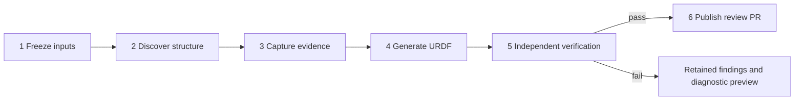

# Design

One operator workflow: **SolidWorks folder → Airflow → independently verified
URDF → review PR**. The tool publishes a candidate; engineering approval and
acceptance for simulation or hardware use remain separate decisions.

## 1. Core principles

Native CAD owns mechanical facts. Versioned controlled records supply explicitly
referenced specifications. Generated definitions and reports retain these sources;
missing or conflicting engineering facts cannot be filled from a reference URDF,
a default parameter or the generator's own output.

Administrative publication identity has a separate authority: CAD values take
precedence, and an authenticated submission may supply absent fields under the
[mechanical identity contract](mechanical-handoff-spec.md#12-工程身份). A
submission owner identifies the submitter when CAD records no owner; it does not
establish mechanical responsibility or engineering approval. The raw CAD record
keeps its original values and absences.

Every boundary verifies the bytes and identities it consumes. Independent
verification reconstructs expectations from sealed native observations and
inspects the actual generated XML, meshes and isolated consumer load. A passing
report qualifies its recorded checks for its exact subject; it cannot prove the
physical truth of the CAD or an approval outside the platform.

`main` contains the smallest complete current system. Previous implementations
remain in Git history. Maintenance replay uses the same generation, verification
and publication rules against complete frozen evidence.

## 2. How the system works

### Sources and responsibilities

| Information | Authority | Responsibility |
|---|---|---|
| Geometry, configurations, occurrences, datums and mechanical declarations | Saved native SolidWorks engineering | Mechanical engineers maintain facts; Windows records them |
| Physical and drive specifications, optional design budgets | Explicit CAD references to immutable controlled records | Parameter owners approve records; Linux resolves the configured library |
| Hardware routing and missing publication metadata | Configured target and authenticated submission, subordinate to CAD values | Maintainer configures routing; submitter confirms the target and change description |
| Robot definition, canonical model, URDF and meshes | Derived from the sealed sources | Linux derives and generates; generated files cannot replace source facts |
| Verification and publication claims | Independently recomputed report and exact Git/PR receipt | Linux verifies the subject and publishes a candidate |
| Physical meaning, full-range safety and intended-use approval | Applicable engineering records and review PR | Responsible engineers approve facts outside automatic coverage |

The workflow has six engineering steps. Their single machine-readable definition
is [`stage-contract.json`](../src/description_pipeline/stage-contract.json); it
renders the table below, the Airflow DAG documentation and the operator view.
Generated-input inspection is the input check of `capture`.



<!-- stage-contract:start -->
| # | Stage | Input | Input QC | Output | Output QC |
|---|---|---|---|---|---|
| 1 | `freeze` — Freeze inputs | Saved SolidWorks folder | Admitted path, regular files and native package | Frozen handoff, file inventory and digest | Exact file inventory and handoff digest |
| 2 | `discover` — Discover structure | Frozen handoff and explicitly referenced component records | Unchanged handoff and controlled discovery settings | Native observations and findings; Derived definition; structural revision when metadata is complete | Resolvable model definition with explicit inspection warnings; Native evidence and original files agree; publication readiness recorded |
| 3 | `capture` — Capture evidence | Prepared definition, saved CAD and native runtime | Derived definition, native provenance and archive integrity; Native Windows, COM and SolidWorks prerequisites | Collected CAD, raw measurements, native meshes and manifest | Complete snapshot with capture and saved-state guards; Original handoff unchanged after capture |
| 4 | `generate` — Generate URDF | Frozen native evidence | Snapshot integrity before consumption | Canonical model; URDF and local meshes; Tool identity and file subject | Valid canonical schema and complete hashed delivery |
| 5 | `verify` — Independent verification | Original evidence and actual generated files | Generated file subject unchanged | Deterministic per-object quality report | All required native, physical, frame, geometry and consumer checks; Saved report equals independent recomputation |
| 6 | `publish` — Publish review PR | Verified delivery and configured model repository | Reverified delivery, clean repository and deterministic review branch | Candidate commit and PR receipt | Copied, staged and committed bytes match the verified subject; Remote commit, PR head/base and subject agree |
<!-- stage-contract:end -->

### Execution across hosts

One Linux server hosts the operator page, Airflow, its database, portable run
store and Git publication. One licensed Windows endpoint serializes native jobs.
Both hosts use the same tool source release and record their respective runtime
dependencies. Git credentials, model checkouts and controlled-record libraries
stay on Linux; Windows requires neither MuJoCo nor GitHub access.

| Airflow task | Engineering responsibility | Execution |
|---|---|---|
| `resolve_handoff` | Admit the Linux intake and bind its complete upload index, main assembly and submission identity | Linux; prepares the native freeze request |
| `start_job`, `wait_for_job` | Drive native freeze, discovery and capture, including the definition exchange | Windows reads native facts; Linux derives the definition during discovery |
| `fetch_capture` | Admit the complete sealed native bundle into the run store | Linux |
| `run_generate`, `run_verify`, `run_publish` | Generate, independently verify and publish | Linux |
| `confirm_job` | Require the complete stage receipt and retain the delivery summary | Linux |

Engineering steps and orchestration tasks have different boundaries. Discovery
spans both hosts: Windows resolves the uploaded main assembly and reads the raw
native record; Linux admits that record against the sealed selection and derives
the prepared definition. Only generated text returns to Windows. The full CAD
folder is not transferred again for this exchange. Windows captures the sealed
engineering and returns immutable native readings, meshes and source copies.
Scene construction, closure arithmetic, structural-team report rendering and
independent verification run on Linux.

Windows receipts cover the native portions of freeze, discover and capture;
Linux receipts cover definition derivation and the portable stages. The full
Airflow run binds both. A completed native job is an intermediate acquisition
state. Maintenance receipts name only the engineering steps they execute and
cannot qualify unexecuted native work.

### Native admission and mechanical interpretation

The whole upload is staged provisionally. SolidWorks itself resolves the main
assembly's references; the pipeline admits the dependency closure from the
engine-reported bindings and the sealed upload index. Engine-materialized imports
require native owner/occurrence evidence binding them to their staged source.
An unresolved or outside-stage source fails before capture. This check happens
after native resolution; it is neither an operating-system sandbox nor a gate
that prevents the engine from reading geometry. The engineering requirements are
in the [mechanical specification](mechanical-handoff-spec.md#32-依赖闭合).

A saved native exporter declaration is explicit mechanical evidence. Discovery
uses its persistent component identities, topology, named frames, axes and
authored limits, regenerating meshes, inertias and non-customized origins from
native CAD. Verification independently decodes the sealed declaration and
reconciles the delivered model with native observations. Saved-pose mate
restrictions remain diagnostics; invalid declarations, unresolved references,
inconsistent geometry and conflicting comparable operating limits fail.

When the declaration is proven absent, discovery and verification independently
reconstruct supported constraints. These are two interpretations of the same
native input workflow, selected by one shared presence predicate; a broken
present declaration cannot silently fall back to inference. Supported topology,
constraints and axis evidence are specified in the
[mechanical specification](mechanical-handoff-spec.md#52-连接与自由度).

Selected-model verification and full-assembly coverage have distinct meanings.
Unassigned occurrences remain explicit with independently measured mass; exact
selected-plus-unassigned mass accounting must pass. This does not establish that
the URDF covers every native occurrence. Direct link mass authority, overrides,
geometry exceptions and numerical tolerances belong to the
[quality specification](quality.md#numerical-contract).

### Integrity and independent verification

Each transfer admits a closed inventory with file hashes, run identity, handoff
selection and tool identity. A generated definition is an input claim to verify,
not an independent oracle. The verifier reconstructs native membership, motion,
frames and physical expectations independently of generation, then checks actual
XML, mesh bytes and isolated MuJoCo loading. Shared schema and presence rules
choose the contract; they do not provide the expected mechanical answer.

Independent verification uses the captured observations; it does not perform a
second physical experiment or certify the CAD's material and motion claims.
The [quality specification](quality.md#scope-of-acceptance) defines the automatic
acceptance limit and the mechanical specification assigns external engineering
confirmation. Passed automatic checks need no repeated manual calculation.

The verified subject binds native inputs, evidence, canonical model, artifacts
and required reports. Receipt and report exclusions prevent circular hashes and
are owned by the [report identity contract](quality.md#report-identity).
Publication rechecks copied output and actual staged/committed Git bytes, preserves
native bytes with generated Git attributes, and confirms remote commit and PR
head/base. Missing required checks, a stale green flag or a changed subject cannot
authorize publication. A diagnostic preview after verification failure stays
explicitly unverified and cannot be published.

### Failures and recovery

Each boundary records its actual result before downstream consumption. Required
checks without prerequisites remain `not_run`; failure blocks dependent work.
Warnings retain their affected objects and qualification impact under the
[step and result contract](quality.md#step-and-result-contract).

Native acquisitions bind the documented interfaces and verify the owned process
and document. Rebuild refreshes the collected document without saving over CAD;
post-capture hashes and configuration guards must pass. Lost bindings or
unreadable state stop work and retain partial diagnostics. Schedule native work
on a dedicated execution host with no independent CAD activity; deployment and
native acceptance must establish process ownership and cleanup behavior.

Every run has a UUID. Transport retries reconnect to that UUID and its frozen
request; terminal native failure or source correction requires a new run. A
linked engineering rerun validates the retained upstream checkpoints and executes
the selected step and its successors, preserving prior evidence and original
check timestamps. A tool change requires a new run from freeze. Frozen complete
evidence can be rebuilt on Linux without reopening CAD; partial evidence cannot.
[Operations](operations.md#6-independent-review-and-recovery) owns the exact
recovery actions.

Live activity reports the operation, object, available counts and timestamps.
It does not change check results or infer progress from successful polling.
The portal serves previews and downloads from the Linux run store and preserves
the distinction between generated, verified and published results. It reports
external review scope without inferring engineering approval.

## 3. How engineering is organized

| Repository or system | Responsibility |
|---|---|
| Public `description-pipeline`, `main` | Current tool, specifications and neutral tests |
| Private model repository, configured base such as `feature/<hardware>` or `main` | Reviewed baseline for that hardware |
| Private model repository, `work/solidworks/<hardware>` | Generated candidate and its review PR |
| Private model repository, `release/<hardware>/<release>` | Approved, frozen model delivery |
| Mechanical PDM, Git LFS or controlled directory | Retrievable CAD revisions and engineering approvals |
| Controlled component library | Versioned physical and drive specifications |

```text
src/description_pipeline/
  stage-contract.json    six steps, boundary checks and responsibility references
  stages.py              check observations and shared result rendering
  steps.py               engineering boundary handlers
  solidworks.py          delivery/replay sequencing and output ownership
  runtime.py             installed tool and dependency identity
  sources/solidworks/    native reading and definition derivation
  model/                 canonical mechanical and physical semantics
  backends/              URDF generation
  verification/          independent native, physical and artifact checks
  repository/            verified Git and PR publication
  orchestration/         queue, Airflow, authentication and result access
tests/                   neutral, analytic and adversarial fixtures
deploy/                  platform installation and lifecycle
docs/                    specifications and operating guides
```

Domain handlers own their checks and action; drivers sequence work and retain
receipts. Rendering cannot execute or qualify engineering work. Maintainers
configure storage, library roots, credentials and hardware routing once, separate
from source inputs, generated output and durable state.

Feishu authentication supplies the submitter's stable app/tenant/`open_id` identity
and original username. Approved users may start new runs and view shared results;
only the initiator and configured administrators may change a run or start a
linked attempt. Credentials remain server-side. Display-name changes and history
deletion do not change engineering identity, evidence or PRs.

## 4. How to operate

[Operations](operations.md) owns preparation, submission, findings, model review
and recovery. [Deployment](deployment.md) owns installation, authentication,
availability, routing, upgrade and rollback. [Quality](quality.md) owns automatic
verification claims; the single Chinese
[mechanical specification](mechanical-handoff-spec.md) owns engineering facts and
confirmation. Tool release evidence follows [RELEASING.md](../RELEASING.md).
