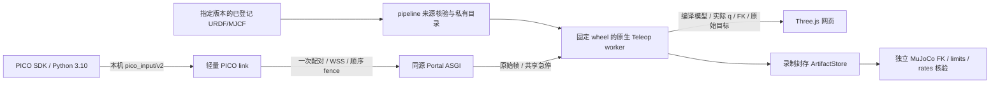

# PICO 上半身 IK：pipeline 集成

本差量基于 MJCF 集成分支，在指定运行的 MJCF 结果增加 `Open PICO Teleop`。它是交互消费者，不增加 Airflow 阶段，不修改原产物或模型资格。首次需要显式 profile；相同 MJCF subject 的已接纳配置可再次一键启动。网页刷新复用会话；启动回执丢失时保留原始请求和幂等键。

首期为固定基座的 `Kinematic IK`：左右手柄分别控制双臂，头显控制 profile 声明的头部关节，腰腿保持初态。任意修订都可进入来源核验，但必须有匹配的关节、TCP、home 与输入旋转配置；不自动猜测名字和缺失自由度。首期受控机械臂只接受有界转动关节。未知碰撞不能显示为无碰撞，inspection 配置也不获得硬件资格。

## 职责与数据流



Teleop 提供唯一的 PICO 解码、稳定中性标定、clutch、IK、限位/速率/碰撞准入和急停核心。pipeline 不实现第二套控制器。浏览器接收实际编译几何与后端位姿，不运行第二份 WASM 物理。

| 文件 | 职责 |
|---|---|
| `simulation/store.py` | PostgreSQL 中的不可变请求、幂等命令、所有权和会话生命周期 |
| `simulation/service.py` | 私有模型物化、固定运行时核验、限额子进程、输入租约、停止及录制 |
| `orchestration/pico_portal.py` | 复用 Portal 会话和实时身份核验、CSRF、同源状态流、一次性设备配对 |
| `static/pico.*` | 指定版本入口、配置、目标/误差/状态展示及停止 |
| `scripts/pico_pipeline_link.py` | 透明转发原始协议；只检查传输顺序、积压和网络有效期，原始字段不重映射 |
| `simulation/verify_recording.py` | 不导入 Teleop/Pin 的独立运动学核验 |

新增 SQL 会话属于交互业务事实，独立于阶段决策。数据库 advisory lock 与本机文件锁分别保证唯一主管和目录所有权。维护 admission 关闭后拒绝新会话并停止现有 worker；生命周期排空包含活动/未决会话。录制进入原有 artifact 表及恢复引用集合，不建立第二份产物状态库。

## 固定运行环境

服务端使用 Python 3.12、MuJoCo 3.13.0，Teleop 固定源为 `8b402482559c02534668bf2cb4338c0b8d628e14`。`simulation/teleop-runtime.json` 绑定本次审查 wheel 的 SHA-256 与全部包文件，启动时拒绝 editable 或字节漂移。平台保留 NumPy 2.5.3；worker 按独立 lock 使用 NumPy 2.4.1 / Pin 4.1.0。

在隔离开发环境安装固定 worker：

```sh
python3.12 scripts/install_teleop_worker.py \
  --wheel /absolute/path/robot_teleop-0.3.0-cp312-cp312-linux_x86_64.whl \
  --destination /absolute/path/teleop-worker
```

离线安装另传 `--wheelhouse /absolute/path/wheels`，其中必须包含 worker lock 的全部 wheel。目标路径必须全新；失败目录保留供诊断。此脚本与固定 wheel 已做真实安装验证。正式发行仍须将通过两仓库审查的 worker 纳入同一 Linux 离线资产，并由唯一发布者安装核验；本差量不代表正式部署已完成。

在唯一 `platform.json` 的 `operator` 中可选启用：

```json
"teleop": {"python": "/absolute/path/teleop-worker/bin/python", "capacity": 2}
```

快照派生仿真根为 `state_root/simulations`；Portal 和 TLS 反代从同一快照渲染。不配置时现有门户继续运行，页面明确提示能力不可用。启用后同一 ASGI 进程挂载原 WSGI 应用，认证存储不复制。正式部署的 worker 路径须位于发行受控私有环境。

## 操作流程

1. 从某次完成的 MJCF 结果打开网页。首个 profile 使用 Teleop `schema_version: 1`，显式填写两臂 joints/frame/tip_offset/home、head_joints、固定关节 home、URDF/MJCF 相对路径和有效输入旋转。完整字段参见 Teleop 的 `RobotProfile` 契约。不把历史机型 profile 当作任意新产物的真值。
2. 确认尺度和关节速度预算，选择是否录制。原生 worker 校验全部来源字节、实际关节范围及零位/非零 TCP 绑定后才进入 ready。
3. 点击 `Pair PICO Link` 取得一次性 60 秒配对码。配对码只从交互输入送给 link，不放进 URL 或命令行。
4. 在操作者电脑为 link 建轻量 Python 3.12 环境，按 `requirements/pico-link-py312.lock` 安装。SDK 仍运行于原有 Python 3.10 环境、网关默认绑定 `tcp://127.0.0.1:5560`。

```sh
python -m pip install --require-hashes -r requirements/pico-link-py312.lock
python scripts/pico_pipeline_link.py \
  --origin wss://operator.example.test \
  --session <session-id-from-portal>
```

5. 保持稳定中性、释放控制器完成标定，再握持跟随。页面显示原始 requested、准入 admitted、实际 applied、误差、clutch、head 和急停。目标球红/橙/绿分别表示 requested/admitted/applied，方向轴显示各目标朝向。
6. 网页急停进入 Teleop 的同一锁存器；普通停止结束进程并封存录制，之后下载。清除锁存仍遵守原有显式中性手势，不因重连自动清除。

link 不使用 CONFLATE。序号缺口、源重启、有界队列溢出或本地积压超过 100 ms 都撤销连接；远程输入必须使用 WSS。服务器回显锚点有效期 250 ms，输入每帧回执，首期按局域网部署。跨主机 monotonic 不相减。网页独占控制、持续心跳和定期授权复核；网页或输入断开时撤销连接。源码轮询频率、真实设备刷新率、控制频率与显示频率分别记录和验收。

## 录制与核验

录制保存原始帧、实际 dt、每拍 q、目标、拒绝原因、版本与显示变换。独立核验从同一精确来源重新加载 MuJoCo，检查源摘要、关节范围/速率、固定关节、显示矩阵及 applied TCP。它不调用 IK 的 pose()，也不把跟随成功解释为动力学或硬件资格。

```sh
python -m description_pipeline.simulation.verify_recording \
  --recording /absolute/path/extracted-recording \
  --source /absolute/path/verified-source-tree
```

异常退出记录标为不完整，未封存原件保留在仿真根。主管崩溃后先等待旧 worker 的管道/watchdog 退出；按 boot ID、PID 和启动时间确认消失后才结算失败。无法确认时保持 unresolved，禁止猜 PID 杀进程；未决记录阻止维护排空。worker 当前每拍记录完整快照，单会话 512 MiB 上限、最长一小时；压缩记录布局是后续 Teleop 差量。

## 验证与后续执行计划

定向测试需显式提供固定 worker 和轻量 link 环境：

```sh
PYTHONPATH=src \
TELEOP_WORKER_PYTHON=/absolute/path/teleop-worker/bin/python \
PICO_LINK_PYTHON=/absolute/path/pico-link/bin/python \
python -m unittest tests.v1.test_pico_sessions -v
```

测试使用真实 PostgreSQL、原生 wheel、HTTP/WebSocket、ZMQ 和通用双臂/头部夹具；连续原始输入实际完成中性标定、两臂位移、头部非零跟随、释放与录制核验；外部 Feishu/Airflow 身份与来源投影边界显式替身。既有 MJCF Portal 测试继续验证真实登记证书/来源读链。软件夹具不能代替实际 PICO 或正式 CAD 流程。

后续门槛依次为：固定候选审查和适用 CI → 收口 Teleop 3.13 六项历史碰撞测试 → 两个真实模型修订的冻结 profile/回放及独立核验 → 真人 PICO 双臂/转腕/头部/释放/断连验收 → 同版 Linux 离线资产、恢复与正式 pipeline/门户组合验收。现有唯一合并、发行和设备所有权保持有效，不以本次开发测试自动晋升。

## 下一轮优化计划（2026-11-01）

本轮规划以 pipeline `428c6470` 和 Teleop `8b402482` 为实现基线；两项 PR 目前均为开放草稿。目标是完成可持续使用、可追溯、可正式交付的 PICO 上半身运动学首版。以下是待实施工作，当前软件夹具通过不代表这些里程碑已经完成。

### 优先级与执行顺序

| 里程碑 | 优先级 | 主要交付 | 验收标准 |
|---|---|---|---|
| M1 控制与证据收口 | P0 | 正常退出、原生命令确认、UNKNOWN 对账、可信录制身份、共享协议 | 停止/断连/崩溃分支可解释；命令能定位实际生效 tick；录制篡改与错误来源被拒绝；六项旧引擎测试收口 |
| M2 两个真实产物修订 | P0 | 实际 URDF/MJCF/网格、冻结 profile、完整门户来源链、性能基线 | 两修订不串来源/profile/输入；真实模型完成双臂与头部跟随；相应 strict/position 语义与源 warning 保真 |
| M3 连续使用性能 | P1 | 输入传输、控制/显示/录制开销优化、长时运行报告 | 代表主机/模型上的控制与显示预算明确；关键原始过渡保留；录制/显示慢消费者不会静默拖慢控制 |
| M4 一键操作体验 | P1 | 结构化 profile 编辑、可解释标定、轻量 link 启动、状态反馈 | 首次配置可定位具体错误；已有匹配配置一键进入；普通用户不用编辑完整 JSON 或手动寻找 worker 路径 |
| M5 真人与正式交付 | P0 发行门 | 真人 PICO 验收、同版离线包、停止/恢复组合、固定候选审查 | 真人、实际产物、同一发行包和网页链路全部有证据；由现有合法合并/发布职责完成交付 |

M1 先固定控制、事件和身份契约；M2 提供真实负载及方向证据；M3/M4 在上述基线上优化；M5 完成最终真人与发行组合。离线包准备可在 worker 契约固定后推进。已有适用证据直接继承，只对发生变化或尚未覆盖的分支增加验证。

### M1：先修正确性与可追溯性

1. **由 worker 自身完成正常退出。** 收口仅发送 `stop`、父管道 EOF、丢心跳、初始化失败、输出堵塞和输入队列满等分支。现有宿主的 `stop` 后关闭 stdin 继续保留，直到新固定 worker 已证明能正常结束读线程；`exit -6` 原件作为回归输入。停止命令送达、会话实际停止和录制封存分别报告。
2. **补齐命令确认与对账。** 复用现有 PostgreSQL 命令记录，以同一 command ID 关联接收、原生实际生效 tick 和结果。请求接纳不直接标为动作生效；进程在发送/生效/保存回执之间崩溃时，原命令进入可核验的 pending/UNKNOWN 对账流程。停止、急停、配对的并发和重复请求按各自语义验证，不重建第二份命令状态库。
3. **将录制绑定外部可信身份。** 当前独立核验从录制内的 `request.json` 读取来源摘要，已证明相对所给来源的 FK/限位/速率一致；正式验收还须以已登记 session 的不可变请求摘要、封存 ArtifactRef 和固定 runtime 身份作为外部锚点。覆盖 request/profile/source/记录内容成组篡改、替换及不完整片段的负例。
4. **记录可重放的控制事件。** 原始帧、网页急停、连接撤销、源重启、控制间隔与实际生效 tick 进入 Teleop 拥有的统一记录契约。现有快照中的结果状态不能代替明确的外部事件。回放复用同一控制核心，独立 MuJoCo 核验负责复算 applied 结果；分别报告控制复现与几何一致性。
5. **与既有 Teleop 动力学任务对齐共享部分。** 由在任设计/实现负责人固定共同源码基线、worker 协议、依赖和 canonical RunRecord 的复用方式；审查 `run-record/3` 对原始输入/会话事件的承载边界。运动学与动力学分别保留明确模式及验收，接纳同一事件和身份契约。
6. **收口 MuJoCo 3.13 回归。** 六项旧测试使用明确可复现的原生零距离边界验证回退路径，同时保留真实 3.13 几何与碰撞测试；不通过跳过测试或放宽物理要求消除失败。将固定 wheel 安装与当前 opt-in 原生集成用例接入必需 CI，使其实际执行而非仅发现后跳过。

交付物为新固定 Teleop wheel/运行时记录、pipeline 差量、原失败输入及定向负例结果。具体 worker/录制实现由现任 Teleop 唯一写者完成，本会话保持 Teleop 源码只读。

### M2：用实际版本产物验证通用性

从现有正式登记来源中选两个不同修订，固定其 URDF/MJCF、所有资源、证书、profile 和运行时；原产物保持只读。profile 准备不需要重新采集 CAD。

- 通过实际网格、include/资源路径、关节顺序、TCP 和 home 绑定运行完整会话，覆盖原生模型物化、网页实际几何及独立记录核验。
- 错 revision、错网格摘要、错 TCP、关节顺序/方向、旧 profile 和旧输入绑定均应被定位并拒绝。
- 校验保存配置后的再次启动、刷新、启动回执丢失重试和跨修订切换；相同 subject 的复用与新 subject 的重新绑定有明确区别。
- 选择任务与实际自由度相符的验收动作；低自由度构型保留 strict 残差、position 模式和未收敛事实，不宣称完整 6D 姿态能力。
- 在隔离、同版的实际 Feishu/Airflow/TLS 门户环境中完成一次组合验证，补足当前原生夹具对身份与来源投影使用的替身边界。

交付每个修订的绑定清单、原始输入、运行记录、独立核验、warning 与失败定位。软件输入验证完成后安排短时真人方向/标定试验；最终真人矩阵在 M5 的冻结候选上收口。

### M3：按测量结果优化输入、显示和录制

先用 M2 模型测量输入采样、接收/入队、每拍求解与准入、结果产生、发送和浏览器显示的耗时；给出 p50/p95/p99、队列深度、超预算/保持比例、CPU/RSS、网络字节率和录制增长率。跨主机时间须明确时钟域、往返估计及误差；当前目标为名义 50 Hz 控制和可见页面约 30 Hz 显示，最终支持预算按固定代表主机的结果确定。

优化方向按基线确认：

- 当前 link 每帧等待一次回执。评估有界发送窗口或按控制拍次发送有序小批量，在保留每个原始过渡的前提下减少往返限制；继续保留 binding、序号、有效期、缓存上限与失效保持。用不同输入率、延迟、抖动和积压重放验证实际支持范围。
- 模型与网格只发送一次；显示采用有序号的最新一致快照。只为显示丢弃过期快照，控制输入、急停与握持事件保留完整顺序。
- 记录优先保存权威输入、事件、实际 dt、目标、q 和准入结果；显示矩阵从同一固定模型重建。根据测量选择按块写入与封存方式，避免每拍完整快照及同步 flush 进入控制预算。
- 浏览器复用状态卡片节点，详细 JSON 按需刷新；检查解析、DOM 更新、绘制和后台恢复对延迟的影响。

以优化前后相同模型、输入和主机比较收益。增加一次一小时连续运行及队列/磁盘/显示慢消费者压力验证；报告实际数据量、资源上限和中断结果。引擎/IK 本身的必要几何和准入检查继续保留。

### M4：让首次配置和日常遥操可操作

- 提供 source-bound profile 表单：从真实关节/链接列表选择两臂、TCP、头部和固定关节，显示单位、输入旋转与任务模式。可从已有 profile 提出候选，候选通过当前产物核验后才成为本修订的已绑定配置。
- 缺失或冲突精确定位到字段/对象；工程未知值保留未知。首次配置由用户明确设置执行条件，已有匹配配置继续一键启动。
- 标定面板展示来自控制核心的阶段、稳定性/释放条件、输入年龄及拒绝原因；每臂单独展示 clutch、requested/admitted/applied、误差与限位/碰撞保持。
- 包装轻量 PICO link 启动入口，自动使用本次会话定位信息，配对码通过交互安全输入。SDK 的 Python 3.10 环境和 link 的轻量环境仍分开，设备连接状态来自实际输入。
- 统一处理启动失败、权限失效、源断连、会话已停止和 UNKNOWN；提供基于权威状态的重试/重新配对操作及录制入口。

验收主路径为“选择产物 → 首次绑定配置 → 启动/配对 → 标定 → 握持遥操 → 停止并保存”；复用已验证配置时缩短为一键进入。JSON 和运行时文件路径保留在高级诊断中。

### M5：完成真人与同一发行交付

真人验收覆盖两臂独立平移/转腕、头部、组合动作、释放保持、回位、急停、断连、重启和恢复；区分空间轴与 controller-local 轴。记录操作者、设备/SDK 身份、profile、源版本、延迟、残差及失败片段，不用软件输入替代。

Linux 离线资产纳入固定 Teleop wheel、全部依赖、私有 worker 环境安装和运行身份核验；轻量 link 单独按设备角色交付。worker 路径由同一发行与现有安装 inventory 派生，日常启用无需选择任意解释器或在线安装依赖。采用当前版本干净首次安装，不增加旧包兼容或跨代恢复链。

在同一候选上验证启动、维护排空、停止、录制封存、未决命令/会话对账、必要诊断原件保全和同版恢复。随后完成固定 head 独立审查、适用 CI、合法合并及唯一发布者的正式 pipeline/门户组合验收。

### 立即安排的三个工作包

1. 固定 M1 的 worker 协议、命令/事件记录和可信核验接口，向在任 Teleop 设计/实现职责形成可审查差量需求；在取得相应任务安排前，本会话不恢复 Teleop 写权。
2. 在 pipeline 隔离分支完成外部身份锚定、命令对账、实际版本绑定测试及性能采样入口；与真实模型基线一起提交定向证据。
3. 按 M2–M5 顺序完成真实模型、性能/体验和真人/发行验收。现任 Teleop 唯一写者、项目负责人及唯一发布者职责保持有效；本计划不改变现场执行权限。
