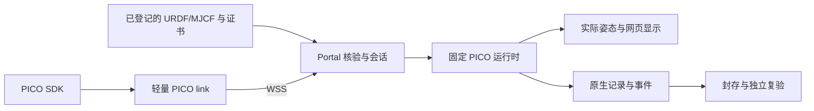

# PICO 上半身 IK

PICO 是指定 URDF/MJCF 产物的交互消费者，不增加主流水线阶段，也不修改模型、证书或工程资格。首期提供固定基座的运动学 IK：双手柄控制双臂，头显控制明确选定的头部关节，其余关节保持软件初态。

## 职责与来源



Teleop 提供输入解码、标定、clutch、IK、限位、速率、碰撞准入和急停核心。pipeline 负责鉴权、来源、调度、运行资源、事实关联和展示；不复制控制算法。浏览器复用现有 Three.js renderer，显示实际后端姿态，不运行第二份物理模型。

请求绑定唯一会话、用户、来源运行、subject、profile、settings 和实际 runtime。配置只可复用到相同 subject；跨修订必须重新核验。模型和必要网格从登记 ArtifactRef 物化，包外路径、未知来源、错误证书或不匹配字节均拒绝。原 warning 与适用范围保持可查看，不能用预览占位建立硬件资格。

## 运行环境

Linux 服务端固定 CPython 3.12。随发行的 `simulation/teleop-runtime.json` 是唯一依赖权威：同一 Teleop wheel 的 `pico` 消费者使用 MuJoCo 3.13，`assessment` 消费者按执行器库要求使用 MuJoCo 3.10。两环境分别安装，主平台不混入 Teleop/Pin 或执行器依赖。

安装器必须显式选择 `--role pico`、`--role assessment` 或 `--role pico-link`。PICO 使用固定 Teleop wheel；assessment 还需要对应的固定 actuator-model wheel。离线 wheel 池和角色 lock 必须来自同一发行，目标环境路径必须全新。安装核验实际 wheel 摘要、依赖、包文件和原生引擎，不采用本地可变检出或旧角色别名。

唯一 `platform.json` 的 `operator` 中可选启用：

```json
"teleop": {"python": "/absolute/path/pico-runtime/bin/python", "capacity": 2}
```

仿真目录从同一配置派生为 `state_root/simulations`。默认关闭时不创建会话或原生环境。启用后，原门户认证与 PICO ASGI 服务共用登录状态；维护 admission 关闭时拒绝新会话并排空已登记资源。正式安装、启停和离线资产操作见 [部署说明](deployment.md)。

PICO SDK 保持在设备原有环境中；轻量 link 使用独立 CPython 3.12 环境和 `requirements/pico-link-py312.lock`，不安装 Teleop 或执行器库。设备 SDK、网络、控制、显示和记录的刷新率分别验收，不相互替代。

## 网页操作

1. 从指定运行的 MJCF 结果打开 `Open PICO Teleop`。首次从实际关节和链接选择双臂、TCP、受控关节与头部，明确 home、输入旋转、任务模式和预算。只有有界转动关节可参与首期控制；不猜测缺失自由度。用户明确选择的源零位或链接原点只属于软件条件。
2. 启动前查看来源、warning 和验证范围。相同 subject 的已接纳配置可再次使用；高级 JSON 导入仍须通过当前来源和字段核验。
3. 使用 `Pair PICO Link` 获取一次性配对码，在操作者电脑启动轻量 link，通过交互输入配对码。配对秘密不进入 URL 或命令行。
4. 稳定保持中性并释放控制器完成标定，再握持跟随。网页分别显示请求目标、准入目标、实际姿态、误差、clutch、头部和急停状态。
5. `Save recording` 选择是否长期保存可下载、可复验的录制。停止后以实际会话状态、进程清场和封存结果判断完成；命令接纳不能显示为已生效。

日常 link 使用安装器生成的启动入口：

```sh
/absolute/path/pico-link/bin/pico-link /absolute/path/pico-link-session.json
```

直接诊断入口接受明确 origin 和 session：

```sh
python scripts/pico_pipeline_link.py \
  --origin wss://operator.example.test \
  --session <session-id-from-portal>
```

link 保留输入顺序。序号缺口、源重启、积压、连接失效及队列溢出撤销连接；不静默丢弃控制事件。连接锚点用于判断有效期，不跨主机相减 monotonic。浏览器持续心跳并复核授权，输入或网页断开进入原生保持/急停规则。

## 命令、停止与未决结果

平台使用 Teleop 的 `worker/1` 命令身份和接纳/生效回执。相同 ID 和载荷只对应同一操作，冲突载荷拒绝；frame、connection、heartbeat、estop 和 stop 的事件保留来源序号及生效 tick。UNKNOWN 先对账原命令，不重新创建 worker 或把超时当作成功。

网页急停进入原生核心的同一锁存器。正常停止、失败、取消、进程未清场和不完整录制分别表示；进程消失不能证明正常退出。资源按实际进程组、boot ID、PID、启动时间和 nonce 绑定。无法核验归属时保留未决状态，不猜 PID 杀进程，也不释放其容量。

`state=stopped` 和停止命令的 `stopped=true` 表示已核实的原生正常停止。后续封存、存储或清理失败通过同一记录的 `error` 和 `session_complete=false` 展示，保留已知的命令与进程事实。可下载录制以实际 `recording_artifact` 为准；失败诊断不证明录制完整。

worker 必需的临时控制证据遵守同一私有目录和容量限制。未选择保存时，仅在正常终态、全部命令已对账且进程组确证退出后清理。失败和 UNKNOWN 原件保全；它们不会被伪称为已经保存的可下载录制。

## 录制与独立复验

录制保留原始输入、命令/事件、实际时间、控制状态与 canonical RunRecord；来源、请求、会话、runtime、完整性和 ArtifactRef 共同绑定。封存后的原件不因版本更新而改写。source root 可重定位，原始来源字节和事件身份不可改写。

封存前在原会话目录核验原进程组已退出、完整目录容量和原生 manifest 自身字节，并将绑定该 manifest 的核验结果保存在外置 outcome。离线复验只消费封存的 proof、manifest、CAS 清单和明确的 source root，不重新访问历史绝对目录，也不修改原 manifest。缺少有效封存证明时无法建立封存资格，不补写或推断为成功。

复验先从数据库和 CAS 核验登记事实，再使用固定 PICO 环境执行公共事件回放与独立 MuJoCo FK，检查状态、关节范围/速率、固定关节、显示变换和实际 TCP。与运行态分开的受管进程不继承 CAD、Git 或数据库秘密。API 和 CLI 共用受管验证能力，登记同一类执行事实、占用同一容量并按实际进程清场；保留原录制的引擎和包身份，不把当前 runtime 替换到旧证据中。下载直接流式读取经核验的 CAS；断开或取消后，先等待实际读取结束再关闭，不额外复制录制或创建临时 ZIP。

原生验证共用一份版本化资源策略：CPU 900 秒、地址空间 4 GiB、最多 128 个文件描述符；录制复验等待上限为 1200 秒。运行时查询与检查保留各自更短的等待上限。超时或取消须结算本次执行并清理自有进程组，保留原录制和失败证据；完整回放与独立 FK 不采样、不跳过。

独立 CLI 使用已安装平台的 Python 和本次安装生成的环境，其中 `PLATFORM_SERVICE_DSN` 提供受管验证所需的服务身份。原生 Python 路径与工作目录从正式生成的 `portal.json` 读取；只读运维身份不承担执行事实写入，不另传 `--python` 或手写第二份配置。

```sh
python -m description_pipeline.simulation.verify_recording \
  --session <registered-session-id> --config /absolute/path/rendered/portal.json
```

运动学一致性、完整事件回放、真实设备输入、持续性能与硬件资格分别验收。软件夹具或原始帧重放不能替代真人 PICO；凸代理接触不能等同于真实曲面干涉。真实模型、设备和性能证据按同发行验收要求给出，不能用绿色 CI 或预览成功代替。
