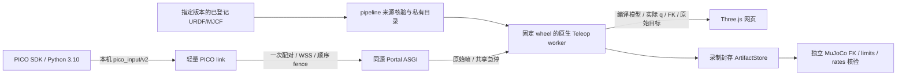

# PICO 上半身 IK：pipeline 集成

本差量基于 MJCF 集成分支，在指定运行的 MJCF 结果增加 `Open PICO Teleop`。它是交互消费者，不增加 Airflow 阶段，不修改原产物或模型资格。首次需要显式 profile；相同 MJCF subject 的已接纳配置可再次一键启动。网页刷新复用会话；启动回执丢失时保留原始请求和幂等键。

首期为固定基座的 `Kinematic IK`：左右手柄分别控制双臂，头显控制 profile 声明的头部关节，腰腿保持初态。任意修订都可进入来源核验，但必须有匹配的关节、TCP、home 与输入旋转配置；不自动猜测名字和缺失自由度。首期受控机械臂只接受有界转动关节。未知碰撞不能显示为无碰撞，inspection 配置也不获得硬件资格。

## 职责与数据流



Teleop 提供唯一的 PICO 解码、稳定中性标定、clutch、IK、限位/速率/碰撞准入和急停核心。pipeline 不实现第二套控制器。浏览器接收实际编译几何与后端位姿，不运行第二份 WASM 物理。

| 文件 | 职责 |
|---|---|
| `simulation/store.py` | PostgreSQL 中的不可变请求、幂等命令、所有权和会话生命周期 |
| `simulation/service.py` | 私有模型物化、固定运行时核验、限额子进程、输入租约、停止及录制 |
| `orchestration/pico_portal.py` | 复用 Portal 会话和实时身份核验、CSRF、同源状态流、一次性设备配对 |
| `static/pico.*` | 指定版本入口、配置、目标/误差/状态展示及停止 |
| `scripts/pico_pipeline_link.py` | 透明转发原始协议；只检查传输顺序、积压和网络有效期，原始字段不重映射 |
| `simulation/verify_recording.py` | 不导入 Teleop/Pin 的独立运动学核验 |

新增 SQL 会话属于交互业务事实，独立于阶段决策。数据库 advisory lock 与本机文件锁分别保证唯一主管和目录所有权。维护 admission 关闭后拒绝新会话并停止现有 worker；生命周期排空包含活动/未决会话。录制进入原有 artifact 表及恢复引用集合，不建立第二份产物状态库。

## 固定运行环境

服务端使用 Python 3.12、MuJoCo 3.13.0，Teleop 固定源为 `8b402482559c02534668bf2cb4338c0b8d628e14`。`simulation/teleop-runtime.json` 绑定本次审查 wheel 的 SHA-256 与全部包文件，启动时拒绝 editable 或字节漂移。平台保留 NumPy 2.5.3；worker 按独立 lock 使用 NumPy 2.4.1 / Pin 4.1.0。

在隔离开发环境安装固定 worker：

```sh
python3.12 scripts/install_teleop_worker.py \
  --wheel /absolute/path/robot_teleop-0.3.0-cp312-cp312-linux_x86_64.whl \
  --destination /absolute/path/teleop-worker
```

离线安装另传 `--wheelhouse /absolute/path/wheels`，其中必须包含 worker lock 的全部 wheel。目标路径必须全新；失败目录保留供诊断。此脚本与固定 wheel 已做真实安装验证。正式发行仍须将通过两仓库审查的 worker 纳入同一 Linux 离线资产，并由唯一发布者安装核验；本差量不代表正式部署已完成。

在唯一 `platform.json` 的 `operator` 中可选启用：

```json
"teleop": {"python": "/absolute/path/teleop-worker/bin/python", "capacity": 2}
```

快照派生仿真根为 `state_root/simulations`；Portal 和 TLS 反代从同一快照渲染。不配置时现有门户继续运行，页面明确提示能力不可用。启用后同一 ASGI 进程挂载原 WSGI 应用，认证存储不复制。正式部署的 worker 路径须位于发行受控私有环境。

## 操作流程

1. 从某次完成的 MJCF 结果打开网页。首个 profile 使用 Teleop `schema_version: 1`，显式填写两臂 joints/frame/tip_offset/home、head_joints、固定关节 home、URDF/MJCF 相对路径和有效输入旋转。完整字段参见 Teleop 的 `RobotProfile` 契约。不把历史机型 profile 当作任意新产物的真值。
2. 确认尺度和关节速度预算，选择是否录制。原生 worker 校验全部来源字节、实际关节范围及零位/非零 TCP 绑定后才进入 ready。
3. 点击 `Pair PICO Link` 取得一次性 60 秒配对码。配对码只从交互输入送给 link，不放进 URL 或命令行。
4. 在操作者电脑为 link 建轻量 Python 3.12 环境，按 `requirements/pico-link-py312.lock` 安装。SDK 仍运行于原有 Python 3.10 环境、网关默认绑定 `tcp://127.0.0.1:5560`。

```sh
python -m pip install --require-hashes -r requirements/pico-link-py312.lock
python scripts/pico_pipeline_link.py \
  --origin wss://operator.example.test \
  --session <session-id-from-portal>
```

5. 保持稳定中性、释放控制器完成标定，再握持跟随。页面显示原始 requested、准入 admitted、实际 applied、误差、clutch、head 和急停。目标球红/橙/绿分别表示 requested/admitted/applied，方向轴显示各目标朝向。
6. 网页急停进入 Teleop 的同一锁存器；普通停止结束进程并封存录制，之后下载。清除锁存仍遵守原有显式中性手势，不因重连自动清除。

link 不使用 CONFLATE。序号缺口、源重启、有界队列溢出或本地积压超过 100 ms 都撤销连接；远程输入必须使用 WSS。服务器回显锚点有效期 250 ms，输入每帧回执，首期按局域网部署。跨主机 monotonic 不相减。网页独占控制、持续心跳和定期授权复核；网页或输入断开时撤销连接。源码轮询频率、真实设备刷新率、控制频率与显示频率分别记录和验收。

## 录制与核验

录制保存原始帧、实际 dt、每拍 q、目标、拒绝原因、版本与显示变换。独立核验从同一精确来源重新加载 MuJoCo，检查源摘要、关节范围/速率、固定关节、显示矩阵及 applied TCP。它不调用 IK 的 pose()，也不把跟随成功解释为动力学或硬件资格。

```sh
python -m description_pipeline.simulation.verify_recording \
  --recording /absolute/path/extracted-recording \
  --source /absolute/path/verified-source-tree
```

异常退出记录标为不完整，未封存原件保留在仿真根。主管崩溃后先等待旧 worker 的管道/watchdog 退出；按 boot ID、PID 和启动时间确认消失后才结算失败。无法确认时保持 unresolved，禁止猜 PID 杀进程；未决记录阻止维护排空。worker 当前每拍记录完整快照，单会话 512 MiB 上限、最长一小时；压缩记录布局是后续 Teleop 差量。

## 验证与后续执行计划

定向测试需显式提供固定 worker 和轻量 link 环境：

```sh
PYTHONPATH=src \
TELEOP_WORKER_PYTHON=/absolute/path/teleop-worker/bin/python \
PICO_LINK_PYTHON=/absolute/path/pico-link/bin/python \
python -m unittest tests.v1.test_pico_sessions -v
```

测试使用真实 PostgreSQL、原生 wheel、HTTP/WebSocket、ZMQ 和通用双臂/头部夹具；连续原始输入实际完成中性标定、两臂位移、头部非零跟随、释放与录制核验；外部 Feishu/Airflow 身份与来源投影边界显式替身。既有 MJCF Portal 测试继续验证真实登记证书/来源读链。软件夹具不能代替实际 PICO 或正式 CAD 流程。

后续门槛依次为：固定候选审查和适用 CI → 收口 Teleop 3.13 六项历史碰撞测试 → 两个真实模型修订的冻结 profile/回放及独立核验 → 真人 PICO 双臂/转腕/头部/释放/断连验收 → 同版 Linux 离线资产、恢复与正式 pipeline/门户组合验收。现有唯一合并、发行和设备所有权保持有效，不以本次开发测试自动晋升。
